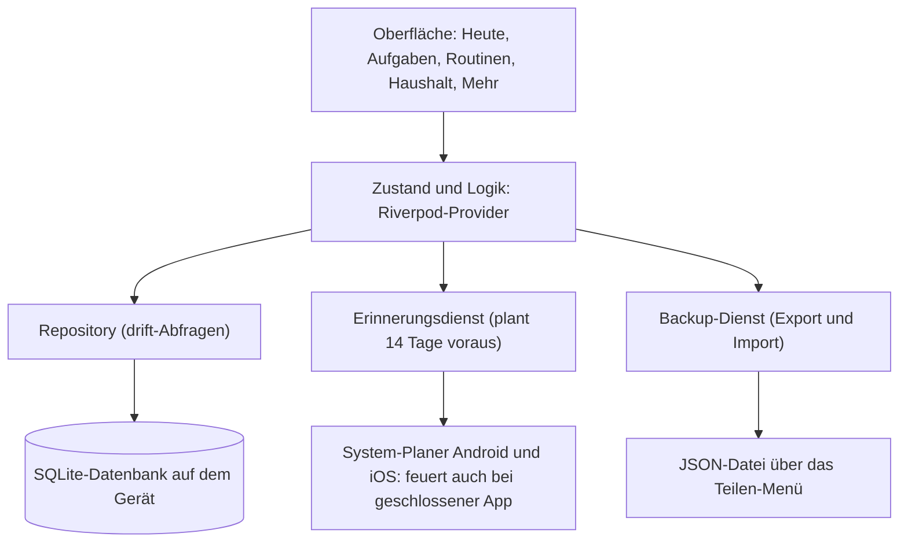

# Spezifikation: Stups, Open-Source-Organisations-App für ADHS (Flutter)

Stand: 17. November 2026. Entscheidungsverlauf: [HANDOFF.md](HANDOFF.md).

## Überblick und Ziele

Wir bauen eine quelloffene Organisations-App für Erwachsene mit ADHS als native Flutter-App für Android und iOS. Sie übersetzt gut untersuchte Strategien aus der ADHS-Therapie in den Alltag: Dinge sichtbar machen, Aufgaben zerlegen, Zeit sichtbar machen und sofort belohnen. Version 1 umfasst drei Bereiche, die sich ein gemeinsames Aufgaben- und Erinnerungssystem teilen.

**Name:** Die App heißt **Stups**, Claim „Rein ins Tun.“ Der Name steht für den kleinen Anstoß im richtigen Moment, der Claim für die eigentliche Hürde bei ADHS: das Tun. Erinnerungen heißen „Stupser“, die Schnellerfassung heißt „Kopf frei machen“, erledigte Dinge zählen als „Taten“. Der Begleiter (Maskottchen) ist frei benennbar und heißt standardmäßig „Stups“.

| Bereich | Version | Kernidee |
| --- | --- | --- |
| Aufgaben und Tagesplanung | 1 | Ein System für alles, ein Tagesplan passend zur Energie |
| Routinen und Gewohnheiten | 1 | Wenn-Dann-Abläufe, Schritt für Schritt geführt |
| Haushalt | 1 | Raumtage, kurze Runden, Vorrat (bisheriges Konzept) |
| Termine | später | Kalender-Anbindung, Vorwarnungen vor Übergängen |
| Finanzen | später | Rechnungen und Fristen |
| Gesundheit | später | Medikamente, Schlaf, Bewegung |

**Ziele**

- Jedes Feature lässt sich auf ein belegtes Wirkprinzip zurückführen
- Zuverlässige lokale Erinnerungen, ohne Server
- Offline-first: alle Daten bleiben auf dem Gerät, kein Konto nötig
- Open Source und kostenlos, verteilt über GitHub Releases, F-Droid, Play Store und App Store
- Wenig Überforderung: jede Ansicht zeigt vor allem den nächsten Schritt

**Nicht in Version 1:** Nutzerkonten, Cloud-Synchronisierung, gemeinsamer Haushalt, Web-Version, therapeutische Wirkversprechen.

## Wissenschaftliche Grundlagen

Die App baut auf den Erklärungsmodellen und Therapieansätzen auf, die für Erwachsene mit ADHS am besten untersucht sind. Belegt ist ihre Wirkung in Therapie-Settings. Ob sie als App genauso wirken, ist offen und muss in Tests mit Betroffenen geprüft werden.

**Achtung:** Alle Quellen wurden ohne Datenbankzugriff aus dem Gedächtnis zusammengestellt. Autoren, Jahre und Aussagen sind vor jeder Veröffentlichung zu prüfen. Details und Prüfliste: [RESEARCH.md](RESEARCH.md).

### Was Organisation bei ADHS erschwert

| Herausforderung | Befund | Quelle (zu prüfen) |
| --- | --- | --- |
| Handeln im richtigen Moment | ADHS stört eher das Umsetzen als das Wissen. Hilfreich ist, Informationen, Zeit und Motivation dort sichtbar zu machen, wo gehandelt wird. | Barkley 1997; Barkley 2010 |
| Belohnungsaufschub | Ferne Belohnungen motivieren deutlich schwächer, Wartezeit wird gemieden. | Sonuga-Barke 2002, 2003 |
| Zeitwahrnehmung | Zeit wird schlechter geschätzt und eingeteilt. | mehrere Übersichtsarbeiten |
| Arbeitsgedächtnis | Nicht festgehaltene Absichten gehen schnell verloren. | Barkley 1997 |
| Emotionsregulation | Emotionale Dysregulation ist häufig. Scham nach Rückschlägen blockiert den Neustart. | Shaw et al. 2014 |

### Was nachweislich hilft

| Ansatz | Kernelemente | Evidenz | Quelle (zu prüfen) |
| --- | --- | --- | --- |
| KVT nach Safren | Ein System aus Kalender und Aufgabenliste, Prioritäten A, B, C, Aufgaben zerlegen, Ablenkung aufschieben, hinderliche Gedanken bearbeiten | Randomisierte Studie: wirksamer als Entspannung plus Aufklärung | Safren et al. 2005, 2010 |
| Metakognitive Therapie | „Was nicht im Planer steht, existiert nicht“, leichter Einstieg, Zeit schätzen und abgleichen | Randomisierte Studie: wirksamer als unterstützende Therapie | Solanto et al. 2010 |
| KVT allgemein | Nutzen bei Erwachsenen bestätigt | Übersichtsarbeiten, Studienqualität niedrig bis moderat | Lopez et al. 2018 (Cochrane) |
| Wenn-Dann-Pläne | Konkreter Auslöser für eine Handlung | Allgemein gut belegt; bei Kindern mit ADHS bessere Impulskontrolle | Gollwitzer & Sheeran 2006; Gawrilow & Gollwitzer 2008 |
| Gewohnheitsbildung | Wiederholung im gleichen Kontext, im Mittel etwa 66 Tage bei großer Spannweite | Längsschnittstudie | Lally et al. 2010 |
| Belohnungssysteme | Wirken, solange sie bestehen; danach lässt der Effekt oft nach | Gut belegt bei Kindern | Leitlinien, Übersichtsarbeiten |
| Bewegung | Moderate Verbesserung exekutiver Funktionen | Metaanalysen, überwiegend Kinder | mehrere Metaanalysen |
| Achtsamkeit | Moderate Effekte | Gemischte Studienlage | mehrere Übersichtsarbeiten |
| Coaching, Body Doubling | Begleitung, Anwesenheit anderer beim Arbeiten | Coaching wenig, Body Doubling kaum untersucht | offen |
| Medikamente | Stärkste Einzelwirkung auf die Kernsymptome | Netzwerk-Metaanalyse | Cortese et al. 2018 |

Leitlinien wie NICE NG87 und die deutsche S3-Leitlinie ADHS empfehlen eine multimodale Behandlung. Die App ergänzt Diagnose und Behandlung, sie ersetzt sie nicht.

## Designprinzipien

Jedes Feature muss mindestens einem dieser Prinzipien dienen. Die rechte Spalte zeigt, aus welcher Grundlage es abgeleitet ist. Zielgruppe sind Erwachsene mit diagnostiziertem oder vermutetem ADHS und alle, denen Selbstorganisation schwerfällt.

| Prinzip | Umsetzung in der App | Grundlage |
| --- | --- | --- |
| Sichtbar am Ort des Handelns | Erinnerungen nennen den konkreten nächsten Schritt, „Heute“ zeigt groß nur ihn | Barkley |
| Ein System für alles | Eine Inbox und ein Tagesplan; Haushalt und Routinen erzeugen Aufgaben im selben System | Safren, Solanto |
| Klein anfangen | Jede Aufgabe hat einen ersten Mini-Schritt, dazu das Angebot „nur 5 Minuten“ | Safren, Solanto |
| Zeit sichtbar machen | Visueller Countdown, Vorwarnungen, geschätzte gegen tatsächliche Dauer | Zeitwahrnehmung, Solanto |
| Sofort belohnen | Haptik, kurze Animation, Taten-Zähler, Feier nach jeder erledigten Aufgabe | Belohnungsaufschub |
| Nie bestrafen | Keine verlierbaren Serien, keine roten Überfällig-Listen, Neustart mit einem Tipp | Belohnungssysteme, Emotionsregulation |
| Wenn-Dann statt Willenskraft | Routinen hängen an Auslösern wie Uhrzeit oder einer vorherigen Routine | Gollwitzer, Lally |
| Ablenkung parken | Notizfeld im Fokusmodus, Einfälle landen in der Inbox | Safren |
| Tagesform berücksichtigen | Morgens Energie wählen, die App plant passend viele Aufgaben | Emotionsregulation |
| Freundlicher Ton | Du-Form, kurze Sätze, keine Vorwürfe | Emotionsregulation |
| Barrierearm | Große Touchflächen, hohe Kontraste, Systemschriftgröße, reduzierte Animationen | Grundanforderung |

## Technische Architektur

Die App ist eine reine Flutter-Client-App ohne Backend. Daten liegen in einer lokalen SQLite-Datenbank, Erinnerungen plant das Betriebssystem selbst. Damit funktioniert alles offline, und die App passt zu F-Droid, das keine proprietären Dienste wie Firebase erlaubt.

| Bereich | Entscheidung | Begründung |
| --- | --- | --- |
| Framework | Flutter (stable), Dart 3 | Eine Codebasis für Android und iOS, später optional Web |
| Plattformen | Android 8+ (API 26). iOS ist vertagt, bis über den Apple-Account entschieden ist. | Android zuerst, weil lokale Erinnerungen bei geschlossener App unverzichtbar sind |
| State-Management-Stil | Riverpod ohne Codegenerierung (handgeschriebene Provider) | Weniger Plugins und Versionskonflikte, gut lesbar für Mitwirkende |
| IDs und Zeit | UUIDs als Text; Zeitpunkte in UTC; Kalendertage als lokaler Text `yyyy-MM-dd` | Vorbereitung auf optionale Synchronisierung; „heute“ bleibt bei Zeitzonenwechsel stabil |
| Code-Struktur | Feature-first: `lib/core/` und `lib/features/<feature>/` mit eigenen Providern, Repository und Widgets | Trägt Routinen und Haushalt als weitere Feature-Ordner |
| State-Management | Riverpod | Testbar, verbreitet, gut für reaktive Datenbank-Streams |
| Datenbank | drift (SQLite) | Relationale Abfragen für Wiederholungen, saubere Migrationen |
| Navigation | go_router | Deklaratives Routing, Deep Links aus Benachrichtigungen |
| Erinnerungen | flutter_local_notifications + timezone | Lokal geplant, kein Server nötig |
| Backup | JSON-Export und -Import über share_plus und file_picker | Datei bleibt beim Nutzer |
| Bilder | Eigene gebündelte Illustrationen, optional eigenes Foto über image_picker | Keine fremden Bildrechte |
| Sprache | flutter_localizations mit ARB-Dateien, Deutsch zuerst | Englisch später ohne Umbau |
| Homescreen-Widget | home_widget (spätere Version) | Heute-Aufgabe ohne App-Start |
| CI | GitHub Actions: Analyse, Tests, Builds, Release-APK | Reproduzierbare Builds für F-Droid |

**Lizenz:** Apache-2.0. Sie ist mit App Store, Play Store und F-Droid vereinbar, enthält eine Patentlizenz und schließt Markenrechte ausdrücklich aus (der Name „Stups“ bleibt beim Projekt).

**Verteilung:** GitHub Releases (APK, signiert über GitHub Actions bei einem Tag `v*` auf `master`) und F-Droid kostenlos, Google Play einmalig 25 $. Ein Apple-Account (99 $ pro Jahr) ist vertagt.

Die Oberfläche spricht nur mit den Providern. Diese nutzen drei Dienste, die direkt in Datenbank, System-Planer oder eine Datei schreiben.

## Navigation

Die App hat 5 Tabs und einen Plus-Button „Kopf frei machen“ für die Schnellerfassung, der unten rechts über jeder Ansicht schwebt. Start ist „Heute“, weil dort der nächste Schritt steht.

1. **Heute:** Energie-Check, nächster Schritt, Tagesplan, Routinen des Tages
2. **Aufgaben:** Inbox, alle Aufgaben nach Bereich, Wochenansicht
3. **Routinen:** Routinen und Gewohnheiten
4. **Haushalt:** Raumtage, Runden, Vorrat und Einkauf
5. **Mehr:** Rückblick und Erfolge, Räume, Einstellungen, Hilfe

Benachrichtigungen öffnen per Deep Link die passende Ansicht, meist direkt den Fokusmodus oder den ersten Schritt einer Routine.

## Aufgaben und Tagesplanung

Alle Bereiche speisen ein gemeinsames Aufgabensystem, damit es nur eine Stelle gibt, an der man nachsehen muss. Das setzt die Kernregel aus Safren und Solanto um: ein einziges Planungssystem, das täglich genutzt wird.

### Kopf frei machen (Schnellerfassung und Inbox)

- Der Plus-Button öffnet ein Eingabefeld, ein Tipp auf „Fertig“ speichert
- Spracheingabe über die Diktierfunktion des Systems
- Einträge landen ohne Kategorie, Datum oder Priorität in der Inbox
- Beim Sortieren wird ein Eintrag zur Aufgabe, zur Routine oder gelöscht

### Aufgaben

- Felder: Titel, erster Mini-Schritt, weitere Unterschritte, geschätzte Dauer, Priorität A, B oder C, Bereich, optional Fälligkeit und Erinnerung
- Beim Anlegen fragt die App: „Was ist der allererste Mini-Schritt?“ Ein Vorschlag aus Vorlagen ist vorausgefüllt.
- Nach dem Erledigen speichert die App die tatsächliche Dauer und zeigt den Vergleich zur Schätzung, ohne Bewertung
- Bereiche: Haushalt, Arbeit, Persönliches, frei ergänzbar

### Heute

- Morgendlicher Energie-Check: wenig, mittel oder viel
- Passend dazu schlägt die App 1, 2 oder 3 Aufgaben vor, dazu die Routinen und den Haushaltsraum des Tages. Es kommen zuerst A-, dann B-, dann C-Aufgaben, jeweils die mit dem frühesten Fälligkeitsdatum zuerst, nie mehr als 3. Gibt es nichts, steht dort „Alles ruhig. Magst du Kopf frei machen?“. Der Vorschlag lässt sich mit einem Tipp ändern.
- Nicht erledigte Aufgaben verfallen aus dem Tagesplan und bleiben in der Aufgabenliste. Es gibt weder eine Überfällig-Liste noch rote Markierungen, höchstens das Angebot „Morgen nochmal?“.
- Groß steht nur der nächste Schritt mit „Los geht’s“, der Rest des Tagesplans ist eingeklappt
- Ist das Tagesziel erreicht: „Für heute geschafft“, optional „Doch noch eine Aufgabe“
- Optionaler Abendrückblick mit drei kurzen Fragen

### Fokusmodus

- Vollbild mit Aufgabe, Unterschritten und visuellem Countdown (5, 10, 15 Minuten oder frei)
- Ablenkungs-Parkplatz: ein Feld für plötzliche Einfälle, die in die Inbox wandern
- Bei Zeitende: „Noch 5 Minuten“ oder „Fertig“
- Jederzeit Ausstieg mit „Für heute reicht’s“

### Wochenrückblick

- Geführter Ablauf von etwa 10 Minuten, einmal pro Woche zur gewählten Zeit
- Schritte: Inbox leeren, kommende Woche ansehen, drei wichtigste Aufgaben wählen, Erfolge der Woche ansehen

## Routinen und Gewohnheiten

Routinen sind Abfolgen kleiner Schritte, die an einem Auslöser hängen. Gewohnheiten sind einzelne Handlungen, die regelmäßig wiederholt werden sollen. Beide setzen auf Wenn-Dann-Pläne statt auf Willenskraft.

### Routinen

- Jede Routine hat einen Auslöser im Wenn-Dann-Format, z. B. „Wenn ich aufstehe, dann …“
- Auslöser in Version 1: Uhrzeit, nach einer anderen Routine, oder manuell gestartet. Ortsbasierte Auslöser folgen später.
- Geführter Ablauf: ein Schritt pro Bildschirm, optional mit Zeit pro Schritt, großer Weiter-Button
- Vorlagen: Morgenroutine, Abendroutine, Nachhausekommen, Haus-verlassen-Check (Schlüssel, Handy, Geldbörse), Arbeitsstart
- Kurzversion: Optionale Schritte lassen sich markieren, „Heute nur kurz“ überspringt sie

### Gewohnheiten

- Ziel als Häufigkeit, z. B. „4 von 7 Tagen“, statt täglicher Pflicht
- Anzeige als Wochenpunkte statt Serie, ein ausgelassener Tag löscht nichts
- Beim Anlegen erklärt die App kurz, dass Gewohnheiten oft mehrere Wochen brauchen und Rückschläge normal sind
- Optional an eine Routine anhängen, z. B. „nach dem Zähneputzen: ein Glas Wasser“

## Haushalt

Der Haushalt bleibt ein eigener Bereich mit dem bisherigen Konzept. Seine Aufgaben laufen über das gemeinsame Aufgabensystem und erscheinen deshalb auch unter „Heute“.

- **Raumtage:** Wochenansicht von Montag bis Sonntag, jeder Tag mit eigener Farbe und standardmäßig einem Raum, optional mehreren (`RoomDay` ist deshalb eine n:m-Beziehung). „Räume verteilen“ verteilt automatisch, freie Tage gehören dazu.
- **Raumansicht:** Fortschritt des Raums, immer nur eine Aufgabe mit Unterschritten, Blättern per Pfeil, Timer und „Los geht’s“
- **Wiederholungen:** täglich, an Wochentagen, am Raumtag, alle n Wochen, monatlich, einmalig
- **Runden:** Mini-Challenges von 5, 10 oder 15 Minuten ohne Vorbereitung
- **Vorrat und Einkauf:** vorbefüllte Liste mit den Status vorhanden, fast leer, fehlt und ungeprüft. Was fehlt, landet auf der Einkaufsliste.
- **Alltagshelfer:** Wohnungsreset (15 oder 45 Minuten), Müllabfuhr mit Erinnerung am Vorabend, Aussortieren
- **Räume:** aus Vorlagen mit fertigen Aufgabenpaketen oder leer anlegen

Nicht erledigte Haushaltsaufgaben landen auf keiner Überfällig-Liste. Angeboten werden nur „Morgen machen“ oder „Diesmal auslassen“.

## Erinnerungen

Erinnerungen, in der App „Stupser“ genannt, sind das wichtigste Werkzeug, um im richtigen Moment zu handeln. Die App plant sie lokal beim Betriebssystem, sodass sie auch bei geschlossener App und ohne Internet kommen. Standardmäßig ist nur wenig aktiv, damit die App nicht nervt.

| Erinnerung | Standard | Zeitpunkt | Beispieltext |
| --- | --- | --- | --- |
| Tagesstart | an | 8:30, einstellbar | „Guten Morgen. Wie viel Energie hast du heute?“ |
| Routine | an, pro Routine | Uhrzeit des Auslösers | „Zeit für deine Abendroutine. 4 kurze Schritte.“ |
| Aufgabe | aus, pro Aufgabe | gewählte Uhrzeit | „Nächster Schritt: Rechnung öffnen.“ |
| Vorwarnung | aus, pro Aufgabe | 10 Minuten vorher | „In 10 Minuten: Wäsche aufhängen.“ |
| Müllabfuhr | an | Vorabend 19:00 | „Morgen kommt die Papiertonne.“ |
| Timer-Ende | immer | Ende des Timers | „10 Minuten geschafft!“ |
| Wochenrückblick | aus | z. B. Sonntag 18:00 | „Magst du kurz auf die Woche schauen?“ |
| Sanfter Wiedereinstieg | an | einmal nach 3 Tagen ohne Öffnen | „Schön, dass du da bist. Wie wär’s mit 5 Minuten?“ |

**Technische Umsetzung**

- Geplant wird ein rollendes Fenster von 14 Tagen. iOS erlaubt höchstens 64 ausstehende Benachrichtigungen pro App. Die App bleibt unter 50 und plant die nächstgelegenen zuerst.
- Neu geplant wird beim App-Start, bei jeder Änderung, nach einem Neustart (Android) und bei Zeitzonenwechsel.
- Android 13+: Berechtigung für Benachrichtigungen, abgefragt im Onboarding mit Erklärung
- Android: ungenaue Alarme, die auch im Ruhemodus feuern. Exakte Alarme brauchen ab Android 14 eine Freigabe und werden nur für das Timer-Ende angefragt, und zwar erst beim ersten Timer-Start mit kurzer Erklärung. Fehlt die Freigabe, kommt ein ungenauer Alarm. Der Countdown beruht auf einem gespeicherten Endzeitpunkt und ist in der App immer exakt.
- Aktionen in der Benachrichtigung: „Erledigt“, „Später“ (1 Stunde) und „Fokus starten“
- Ruhezeiten: In einem einstellbaren Fenster (Standard 22:00 bis 7:00) plant die App nichts ein
- Fehlt die Berechtigung, zeigt „Heute“ einen freundlichen Hinweis mit Link zu den Systemeinstellungen

## Onboarding, Einstellungen und Backup

**Onboarding** dauert höchstens 7 Bildschirme und lässt sich jederzeit überspringen. In v0.1 gibt es nur die Schritte 1, 2 und 6; die übrigen kommen mit den Bereichen, zu denen sie gehören.

1. Willkommen: was die App kann, plus der Hinweis, dass sie keine Diagnose oder Behandlung ersetzt
2. Begleiter benennen: „Wie soll dein Begleiter heißen?“, vorausgefüllt mit „Stups“
3. Bereiche wählen: Aufgaben, Routinen und Haushalt, alle vorausgewählt
4. Eine erste Routine aus Vorlagen wählen
5. Haushalt: Räume und Raumtage wählen (entfällt, wenn Haushalt abgewählt ist)
6. Erinnerungen: Uhrzeit für den Tagesstart, danach die Berechtigungsabfrage
7. Fertig: ein erster Mini-Schritt von 5 Minuten als Startangebot

**Einstellungen**

- Bereiche ein- und ausblenden
- Erinnerungen, Ruhezeiten, Tag und Uhrzeit für den Wochenrückblick
- Wochenbeginn (Montag oder Sonntag)
- Design hell, dunkel oder wie das System
- Animationen reduzieren, Haptik, Begleiter anzeigen und umbenennen
- Sprache
- Daten: Export, Import, alles zurücksetzen
- Über die App: Version, Lizenzen, Quellen, Link zum Quellcode

**Backup:** Der Export erzeugt eine JSON-Datei mit Schemaversion und teilt sie über das Teilen-Menü des Systems. Der Import ersetzt nach Bestätigung alle Daten, vorher legt die App automatisch eine Sicherheitskopie an.

## Datenmodell

Kern ist eine gemeinsame Task-Tabelle für alle Bereiche. Aufgaben (die Regel) sind von Vorkommen (ein konkreter Tag) getrennt. Vorkommen werden aus Wiederholungsregeln berechnet und erst gespeichert, wenn jemand sie startet, abhakt, verschiebt oder auslässt.

| Tabelle | Wichtige Felder | Beziehung |
| --- | --- | --- |
| Area | id, name, colorKey, iconKey, builtIn | hat viele Tasks |
| InboxItem | id, text, createdAt | wird zu Task oder Routine, oder gelöscht |
| Task | id, areaId, roomId (optional), title, firstStep, note, estimateMin, priority (A, B, C), dueDate, recurrence (JSON), reminderAt, warnMin, active | hat Subtasks und Occurrences |
| Subtask | id, taskId, title, sortOrder | gehört zu Task |
| Occurrence | id, taskId, date, status, startedAt, completedAt, actualMin | ein Tag einer Task, Basis für den Schätzabgleich |
| SubtaskCheck | occurrenceId, subtaskId, done | Haken pro Tag |
| DayPlan | date, energy, plannedTaskIds (JSON), reviewNote | Grundlage für „Heute“ |
| DistractionNote | id, text, createdAt, occurrenceId | aus dem Fokusmodus, wandert in die Inbox |
| Routine | id, title, triggerType, triggerValue, afterRoutineId, active | hat RoutineSteps und RoutineRuns |
| RoutineStep | id, routineId, title, durationSec, optional, sortOrder | gehört zu Routine |
| RoutineRun | id, routineId, date, completedSteps, finishedAt | für Rückblick und Erfolge |
| Habit | id, title, targetPerWeek, routineId | hat HabitChecks |
| HabitCheck | habitId, date | ein erledigter Tag |
| Room, RoomDay, Challenge, ChallengeRun, SupplyItem, ShoppingItem, TrashBin | wie im Haushaltskonzept | Bereich Haushalt |
| Setting | Schlüssel, Wert | allgemein |

Die „Taten“ sind keine eigene Tabelle, sondern werden aus den erledigten Occurrences berechnet. `Task.recurrence` und `Occurrence` sind von Anfang an im Schema. In v0.1 gibt es nur einmalige Aufgaben mit genau einer Occurrence; die Wiederholungs-Engine folgt mit Routinen (v0.2) und Haushalt (v0.3). Alle IDs sind UUIDs als Text.

Vorlagen (Routinen, Raumpakete, Challenges, Vorratsliste, Vorschläge für erste Mini-Schritte) liegen als JSON-Dateien in den App-Assets. Das Backup-Format ist ein JSON-Abbild aller Tabellen plus `schemaVersion`.

## Design

Grundlage ist der klickbare Prototyp (siehe [../prototypes/README.md](../prototypes/README.md)).

- **Farben:** heller Lilagrund (#F6F4FF), Text in Tinte (#1F1A3D), Violett (#5B3DF5) als Hauptfarbe, Sonnengelb (#FFC93C) für Start-Momente, Mint (#19C39C) für Erledigtes, Pastelltöne je Wochentag und Bereich
- **Schrift:** Fredoka für Überschriften, Lexend für Text
- **Knöpfe:** leichte 3D-Kante, die beim Tippen einsinkt
- **Begleiter:** das Staubwölkchen aus dem Prototyp, frei benennbar, standardmäßig „Stups“; erscheint bei Begrüßung und Erfolgen, abschaltbar. Die Gestalt kann nach Tests mit Betroffenen noch angepasst werden.
- **Launcher-Icon:** gelber Punkt mit zwei Wellenringen (der „Stups“) auf Violett (#5B3DF5); vorläufig, bis das Logo steht
- **Eine Sache pro Bildschirm:** der nächste Schritt groß, alles andere zurückhaltend oder eingeklappt
- **Feier:** Konfetti nach erledigten Aufgaben. Animationen sind abschaltbar, die Systemeinstellung „Bewegung reduzieren“ wird respektiert.
- **Ton:** Du-Form, kurz, ermutigend, nie vorwurfsvoll
- **Dunkelmodus** von Anfang an

## Rechtliches und Ethik

Die App versteht sich als Alltagshilfe, nicht als Behandlung. So fällt sie voraussichtlich nicht unter die EU-Medizinprodukteverordnung (MDR); das ist vor der Veröffentlichung rechtlich zu prüfen.

- **Formulierungen:** „unterstützt im Alltag“ und „basiert auf Strategien aus der Forschung“. Keine Aussagen wie „behandelt ADHS“ oder „reduziert Symptome“.
- **Hinweis** in Onboarding und Hilfe, dass die App keine Diagnose oder Behandlung ersetzt
- **Datenschutz:** Daten bleiben auf dem Gerät, keine Analyse- oder Werbe-Tracker
- **Gesundheitsdaten:** Sobald Gesundheitsfunktionen wie Medikamenten-Erinnerungen dazukommen, gelten diese Daten als besonders geschützt (Art. 9 DSGVO). Lokale Speicherung und optionale Verschlüsselung sind dann Pflicht.
- **DiGA:** Eine spätere Zulassung als digitale Gesundheitsanwendung wäre ein bewusster eigener Schritt mit Nachweispflicht

## Roadmap

Das MVP setzt zuerst den Kern um, der für alle Bereiche gilt: erfassen, zerlegen, fokussieren, erinnern. Routinen und Haushalt bauen darauf auf. Nach jeder Version wird mit Betroffenen getestet.

1. **v0.1 MVP:** Inbox, Aufgaben mit erstem Mini-Schritt und Unterschritten, Heute mit Energie-Check, Fokusmodus mit Ablenkungs-Parkplatz, Tagesstart-Erinnerung, JSON-Backup, Onboarding mit 3 Bildschirmen, einfache Feier mit Haptik und Konfetti, Taten-Zähler, Begleiter. Android-APK über GitHub Releases, zunächst nur an einen kleinen Testkreis.
2. **v0.2:** Routinen mit Vorlagen und Erinnerungen, Gewohnheiten, Wochenrückblick. Eine iOS-Testversion über TestFlight folgt erst, wenn über den Apple-Account entschieden ist.
3. **v0.3:** Haushalt komplett (Raumtage, Raumansicht, Runden, Vorrat, Müllabfuhr), Abgleich von geschätzter und tatsächlicher Dauer, Erfolge, F-Droid-Aufnahme
4. **v1.0:** Veröffentlichung im Play Store und App Store, Englisch, Barrierefreiheits-Prüfung
5. **Danach:** Termine mit Kalender-Anbindung, Finanzen, Gesundheit, Homescreen-Widgets, ortsbasierte Routinen, optionale Synchronisierung, Body-Doubling-Funktion

## Offene Fragen

- [ ] Quellen mit Websuche oder Fachdatenbank verifizieren (Ticket 00, vor dem ersten öffentlichen Release)
- [ ] Fachliche Begleitung gewinnen, z. B. eine Therapeutin oder einen Therapeuten mit KVT-Erfahrung bei ADHS (vor v1.0)
- [ ] Rechtliche Prüfung der Abgrenzung zum Medizinprodukt (vor v1.0)
- [ ] Logo gestalten und Verfügbarkeit von „Stups“ prüfen: Marke, App Stores, Domain, GitHub (vor dem ersten öffentlichen Release)
- [ ] iOS: Apple-Account (99 $ pro Jahr) und Build-Weg ohne Mac, vertagt

Entschieden sind inzwischen: Lizenz (Apache-2.0), Plattform-Reihenfolge (Android zuerst), Mindestversion Android 8, ein Raum pro Tag als Standard, verpasste Aufgaben verfallen aus dem Tagesplan, Gestalt des Begleiters (Staubwölkchen). Details in [HANDOFF.md](HANDOFF.md).
